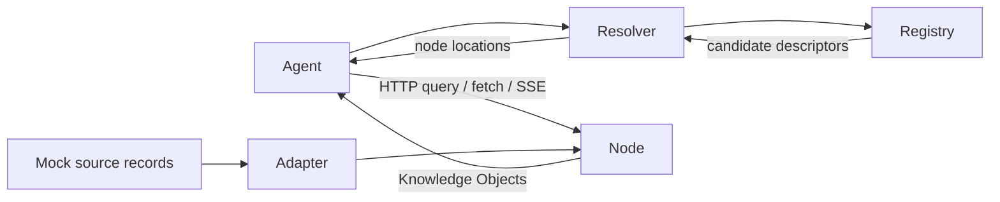

# AIW · Protocol Prototype v0.1

**Experimental — AI-Native Knowledge Exchange Network.** A small HTTP prototype for discovering providers and retrieving structured, provenance-aware Knowledge Objects.

[한국어 안내](README.ko.md) · [Architecture](docs/architecture.md) · [Protocol](docs/protocol.md) · [Object contract](docs/knowledge-object.md)

## Problem and hypothesis

Agents sometimes turn human-oriented HTML into structured information through parsing and extraction. Where structured information already exists, repeated UI interpretation may be avoidable. **When information is already machine-readable, agents should be able to discover and retrieve self-describing knowledge directly.** This repository explores that hypothesis through working software, without claiming novelty or universal performance advantages.

## Architecture



The **control plane** discovers nodes, namespaces, schemas and capabilities. The registry stores descriptors only; the resolver is a TypeScript library that performs registry HTTP lookups. The **knowledge plane** carries objects, source metadata, evidence, provenance, versions and subscriptions directly between client and node. The resolver does not proxy knowledge.

One local node hosts weather, finance and conflicting-provider examples. Its operator is distinct from each object's publishing provider. No database, LLM, Docker or external data service is required.

## Quick start

Install [Node.js 24 LTS](https://nodejs.org/en/download) and pnpm 12 (tested with 12.6.0). Node 22 is also covered by CI. From this directory:

```sh
pnpm install
pnpm demo
```

The demo starts two real HTTP servers on available loopback ports, registers the node's advertised descriptor, discovers it through the resolver, queries Seoul temperature, fetches by ID, and closes both servers. The agent receives only the registry URL; it does not contain a weather-node URL.

```sh
pnpm dev                # registry :4000, node :4001; Ctrl+C stops both
pnpm demo:finance       # Samsung Electronics → KRX:005930; fictional price
pnpm demo:conflicts     # both 10231 and 10417; no winner
pnpm demo:derived       # deterministic range with two versioned inputs
pnpm demo:subscribe     # receive one changed weather object over SSE
pnpm benchmark
pnpm typecheck
pnpm lint
pnpm test
pnpm build
pnpm format:check
```

All data is **fictional/mock**. The fixed initial timestamp is not a current observation. SSE simulates new observations. The build emits runnable JavaScript into ignored `dist/`; `node dist/scripts/demo.js` runs the compiled demo.

## Knowledge Object

An object may be an observation, claim, inference, record, event, or document reference. It is not automatically a fact. Required identity, schema, namespace, subject/property/value, provider, origin, creation timestamp and version form the core. Source, evidence, provenance, units and other timestamps are optional metadata. Derived origins require versioned input references.

With `pnpm dev` running, discover before querying:

```http
GET http://127.0.0.1:4000/discover?namespace=weather.kr&capability=query

POST {discovered endpoint}/query
Content-Type: application/json

{"namespace":"weather.kr","subject":"geo:kr:seoul","property":"weather.air-temperature"}
```

The response is an `objects` array containing an object shaped like this (initial fixture; provenance omitted here for brevity):

```json
{
  "id": "weather:seoul",
  "type": "observation",
  "schema": "weather.temperature.v1",
  "namespace": "weather.kr",
  "subject": "geo:kr:seoul",
  "property": "weather.air-temperature",
  "value": 18.2,
  "unit": "C",
  "provider": {
    "id": "demo-weather-provider",
    "name": "Demo Weather Provider"
  },
  "source": {
    "id": "mock-weather-source",
    "description": "Fictional local weather reading",
    "mock": true
  },
  "originType": "measurement",
  "observedAt": "2026-09-29T00:00:00.000Z",
  "createdAt": "2026-09-29T00:00:00.000Z",
  "version": 1
}
```

## Repository

| Path                 | Responsibility                                                     |
| -------------------- | ------------------------------------------------------------------ |
| apps/registry        | In-memory descriptor registration and discovery                    |
| apps/weather-node    | Generic in-memory node hosting demo namespaces                     |
| apps/demo-client     | Command-line agent with actual discovery                           |
| packages/core        | Zod wire contracts, errors and structural verification             |
| packages/client      | Validated query/fetch and streaming client                         |
| packages/resolver    | Registry-backed discovery library                                  |
| packages/adapter-sdk | Source-to-object adapter interface                                 |
| examples             | Weather adapter, fictional finance, conflicting claims, derivation |
| scripts              | Service lifecycle, demos and synthetic benchmark                   |
| tests                | Contract, API and real HTTP/SSE integration tests                  |
| docs                 | Decisions, protocol, terminology, comparison and roadmap           |

## Design principles

- Representation is independent of storage. Nodes can wrap existing APIs, SQL, RDF, files or sensors through adapters.
- Provider (publisher), source (origin), evidence (support), and provenance (transformations) remain separate.
- Discovery returns candidates, without trust ranking. Conflicting objects remain visible.
- AI-generated origins are explicit; derived objects refer to their inputs. The demo computes a range deterministically without an LLM.
- Use HTTP, JSON and SSE, with strict validation at boundaries.

## Non-goals

v0.1 does not replace HTTP, the Web, search engines, MCP, A2A or RDF. It does not build AGI, a global truth database, cryptocurrency, blockchain consensus or a new transport layer, and does not solve all ontology or global identity problems. AIW is neither a database nor an LLM nor primarily an agent chat protocol.

## Benchmark and related work

`pnpm benchmark` compares local parsing of a synthetic HTML page and a JSON Knowledge Object containing equivalent weather fields. It reports bytes, explicit extraction operations and timing over multiple iterations. It excludes network, compression and LLM costs; it does **not** prove AIW is universally faster than the Web. See [methodology and output format](docs/benchmark.md).

REST APIs, RDF/Semantic Web, JSON-LD, knowledge graphs, MCP, A2A and existing machine-readable web interfaces already address related needs. This experiment combines discovery with a small knowledge envelope; it is not a claim to invent the first AI internet. See the respectful [comparison and primary references](docs/comparison.md).

## Limitations and roadmap

Local trusted demonstration only: no authentication enforcement, persistence, schema registry, provider verification, federation, pagination, historical retrieval or SSE replay. Structural verification cannot prove truth. Namespace/schema strings are conventions, not an ontology. Do not expose the registry publicly: registrations are unauthenticated and client endpoints must be trusted.

v0.2 explores schemas, entities, provider identity and established authentication; v0.3 explores JSON-LD/RDF and MCP adapters. Federation, signatures and alternative encodings remain research. See [roadmap](docs/roadmap.md) and [security](docs/security.md).

## Contributing and license

Small, reviewable contributions and explicit tradeoffs are welcome. Read [CONTRIBUTING.md](CONTRIBUTING.md), run the checks, and keep demo data fictional. MIT licensed; see [LICENSE](LICENSE).
