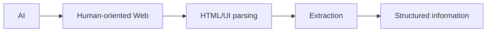
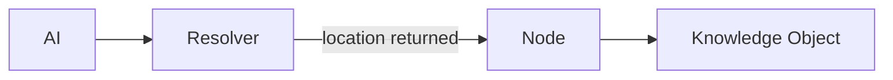
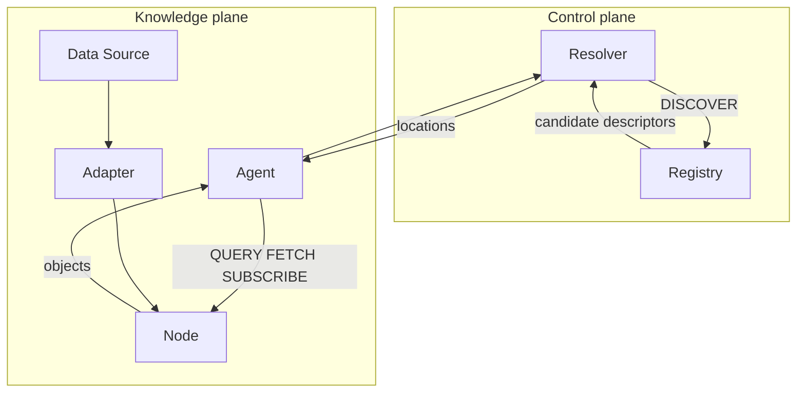

# Architecture and rationale

AIW Protocol Prototype v0.3 is experimental. It tests machine-agent-oriented knowledge discovery and exchange over normal HTTP.

## Conceptual comparison

These simplified diagrams compare two possible retrieval paths. They do not imply every website requires UI interpretation: APIs, structured markup and linked data already exist.

## Components and responsibilities

The registry exists to answer where knowledge may be found without collecting the knowledge itself. Its mutable in-memory map is metadata only. The resolver separates discovery policy from clients and returns all matching candidates. It is a library in v0.2, avoiding an extra service hop. A node exposes knowledge while adapters separate source-specific mapping from HTTP. Nodes need not own source data. The demo agent is ordinary TypeScript, not an LLM.

Core owns wire contracts, not storage or transport. The client validates incoming contracts, and Fastify apps map failures to common errors. Fixtures make review reproducible. The weather node name reflects the main demo; the same process also hosts finance and organization namespaces. Multiple object providers can share one node operator.

## Meaning and trust

**AIW transports evidence; it does not manufacture truth.** Two employee-count claims are returned independently, preserving provider and source context. Their deterministic min/max derivative is a summary of those inputs, not a resolution of disagreement. Consumers decide what to trust for their use case.

Provider identifies responsibility for publishing. Source identifies origin. Evidence describes supporting material or references. Provenance records transformations. These metadata are assertions, not authenticated proof. Origin distinguishes measurements, official records, human statements, research, imports, AI inferences and other derived data. Mock measurements explicitly mark their source as mock.

## Tradeoffs

Opaque IDs and integer versions make local derivations easy to inspect. A bounded in-memory store retains immutable versions; node verification resolves direct references against those exact versions. There is no graph database, remote crawling, or cycle analysis beyond direct self-reference. SSE broadcasts simulated weather changes and cleans up listeners on disconnect; slow clients are disconnected. There is no replay or delivery guarantee. HTTP addresses are endpoint roots; path-prefix deployments are not supported.

The control plane includes schema identifiers and capability metadata. Nodes publish a fixed domain JSON Schema catalog and validate ingestion; cross-field constraints are additionally enforced in TypeScript. Queries return latest versions in bounded cursor pages; historical fetches address exact retained versions. Neither history nor the registry survives a restart. Future authentication can implement the AuthorizationPolicy interface with established mechanisms; the current apps do not enforce it.

## v0.2 dashboard and external adapter

The node also serves the dashboard assets. The browser discovers the configured local node through the registry, then queries and subscribes directly; it does not forward object traffic through the registry. Browser destinations are restricted to the configured node. The command-line Resolver remains a reusable library.

Live mode replaces only the fictional weather fixture with imported Open-Meteo model data. Finance and conflicts remain mocked. An API failure leaves weather absent, or retains the last good value with explicit error status. No custom transport or database was added.
